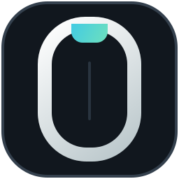
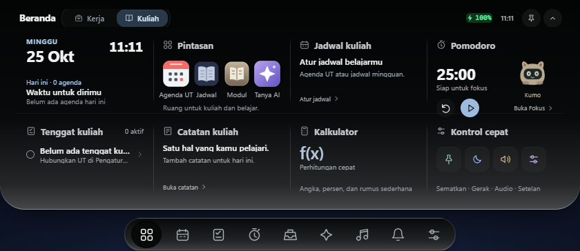
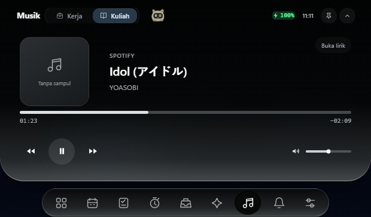
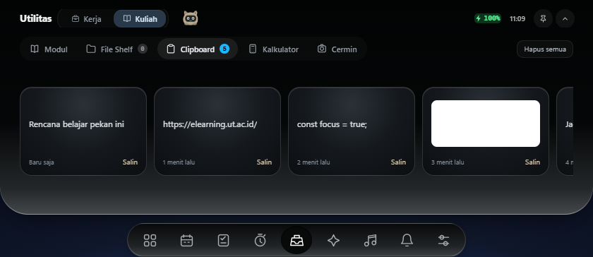

  
  <h1>zeronotch</h1>
  
A focused notch workspace for Windows.

  

    <a href="https://github.com/fadilismee/zeronotch/releases/latest"><strong>Download the latest release</strong></a>
    ·
    <a href="https://cebanmatters.com/zeronotch">Support zeronotch</a>
  

  

    
    
    
  

zeronotch turns the area around your Windows notch into a compact workspace.
Switch between **Work** and **Study** so the interface only shows the tools that
matter in the current context.

## Highlights

- **Two focused modes** — keep work utilities and university tools separate.
- **Study workspace** — tasks, UT calendar, focus timer, study streak, notes,
  module search/download, and the interactive Kuma companion.
- **Everyday utilities** — File Shelf, scrollable clipboard history, calculator,
  mirror, and configurable app shortcuts.
- **Media controls** — compact playback controls with an optional dedicated
  lyrics view.
- **Optional AI** — connect an OpenAI-compatible endpoint using your own
  configuration.

<table>
  <tr>
    <td></td>
    <td></td>
  </tr>
  <tr>
    <td align="center">Compact media controls</td>
    <td align="center">Scrollable clipboard cards</td>
  </tr>
</table>

## Install

1. Open [Releases](https://github.com/fadilismee/zeronotch/releases/latest).
2. Download the newest `zeronotch-Setup-vX.Y.Z.exe` asset.
3. Run the installer, then launch zeronotch from the Start menu.

The installer is currently unsigned. Windows SmartScreen may therefore identify
it as an unrecognized app. Release notes include the SHA-256 checksum so you can
verify the downloaded file.

## Requirements

- Windows 10 or Windows 11, 64-bit
- Python 3 only when using the module downloader
- Camera permission only when opening Mirror
- Internet access only for features you connect, such as UT, module downloads,
  lyrics, or an AI endpoint

## Privacy

zeronotch keeps workspace state on the device. Camera preview is local and is
not recorded by the app. Account, AI, and network-backed features are used only
after you configure or open them.

## Current limitations

- The Windows installer is not code-signed yet.
- UT sign-in and calendar synchronization depend on the university service and
  should be validated with your own account.
- Module downloads currently require Python 3.
- zeronotch uses Electron, so Windows may show several helper processes in Task
  Manager even though they belong to one application.

## Support the project

zeronotch is developed independently. If it helps your day, you can support its
continued development at [cebanmatters.com/zeronotch](https://cebanmatters.com/zeronotch).

## License

zeronotch is distributed under the GNU General Public License v3.0.

